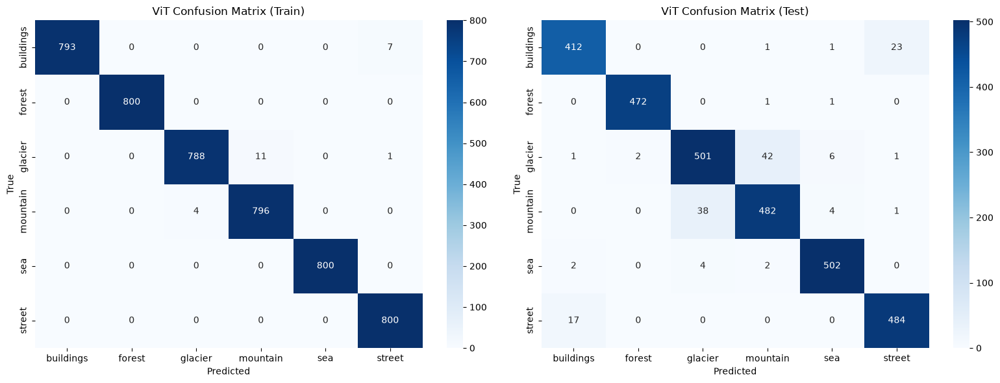

# Vision-to-Text Pipeline: ViT Scene Classification + LLM Descriptions

An image goes in and a short written description comes out. A Vision Transformer fine-tuned on six scene classes identifies what the image shows, and a small language model writes a few sentences about that class. Two guardrails stop the language model from describing something the classifier isn't sure about, or from rambling and repeating itself.

Built as a project for INFO 4000 (Informatics III) at the University of Georgia.

## How it works

```
image ──> fine-tuned ViT ──> predicted class + confidence
                                   │
                    confidence < 0.60? ──yes──> stop, no description
                                   │ no
                                   v
             Qwen2.5-0.5B with a fixed prompt template ──> description
```

1. **Classify.** `google/vit-base-patch16-224` (pretrained on ImageNet) is fine-tuned with the Hugging Face `Trainer` on the Intel scene dataset: buildings, forest, glacier, mountain, sea and street. The 1000-class ImageNet head is replaced with a new 6-class head.
2. **Check confidence.** If the top softmax probability is below 0.60, the pipeline stops and never calls the language model. A low-confidence label is likely wrong, and the LLM would describe it confidently anyway.
3. **Describe.** The predicted class fills a fixed template, `Description of a [class]: The [class] is typically`, and `Qwen/Qwen2.5-0.5B` finishes the sentence. Decoding is set up so the output stays on topic and never loops:
   - `do_sample=False`: greedy decoding, so the same image always gives the same text
   - `repetition_penalty=1.3`: discourages reusing tokens
   - `no_repeat_ngram_size=3`: blocks any 3-word phrase from appearing twice
   - output trimmed to at most three complete sentences

## Results

| Metric | Value |
|---|---|
| Test accuracy (3,000 held-out images) | **95.1%** |
| Train accuracy | 99.5% |
| New, unseen images classified correctly | **8 / 8** (all above 98% confidence) |



Most of the remaining errors fall into two pairs of classes that genuinely look alike:

- **glacier vs mountain**: 42 glacier images were labeled mountain and 38 mountain images were labeled glacier. Snowy peaks appear in both classes, so some of these images could fit either label.
- **buildings vs street**: 23 buildings images were labeled street and 17 street images were labeled buildings, since most street photos contain buildings and the reverse.

Forest was close to perfect (99.6% F1) because nothing else in the dataset is mostly trees.

### Example output

```
Image:       street1.jpg
Prediction:  street
Confidence:  0.9975
Description: The street is typically lined with buildings, and the streets are often
             wide enough for cars to drive on. There may be sidewalks or pedestrian
             walkways in some areas.
```

The full run, including every prediction, probability chart and description, is saved in `vision_to_text_pipeline.ipynb`.

## Run it yourself

**1. Get the data.** Download the Intel Image Classification dataset ([Kaggle](https://www.kaggle.com/datasets/puneet6060/intel-image-classification)) and arrange it like this, next to the notebook:

```
Objects/
    train/  buildings/ forest/ glacier/ mountain/ sea/ street/
    test/   buildings/ forest/ glacier/ mountain/ sea/ street/
    new/    any .jpg images you want to describe
```

The `new/` images are named after their class (for example `forest.jpg`, `street1.jpg`) so the notebook can check its own predictions. Unnamed images still work; they just won't get an expected label.

**2. Install dependencies** (Python 3.12 or 3.13):

```bash
python -m venv .venv
source .venv/bin/activate
pip install -r requirements.txt
```

**3. Run the notebook** top to bottom. The first run downloads the ViT (~350 MB) and Qwen2.5-0.5B (~1 GB) from Hugging Face. On an Apple Silicon Mac (MPS), training on 800 images per class for 3 epochs took about an hour. The cap is set by `MAX_TRAIN_PER_CLASS` in the settings cell; set it to `None` to train on the full set.

The fine-tuned model is saved to `vit_objects_model/` and reloaded from disk for the inference step. The weights (~330 MB) are not included in this repo.

## Tech

Python, PyTorch, Hugging Face Transformers and Datasets, scikit-learn, Matplotlib, Seaborn
